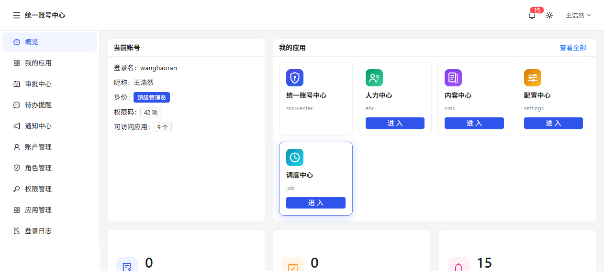
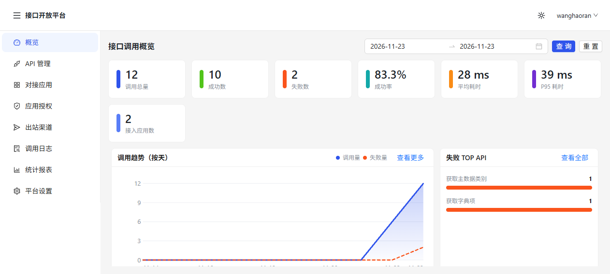
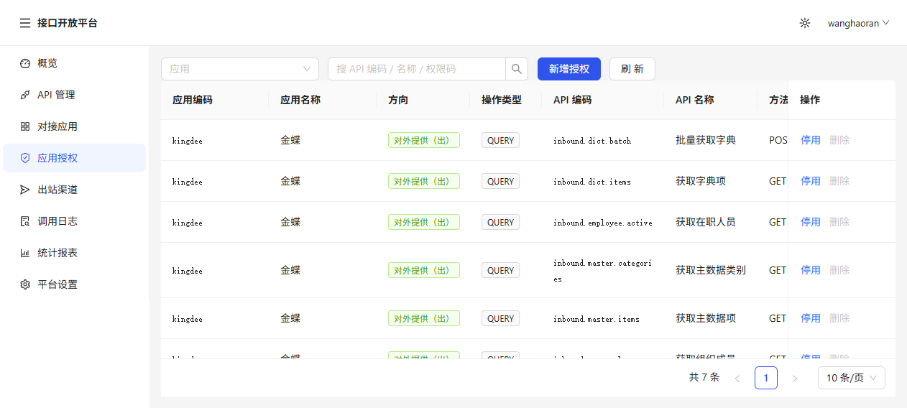
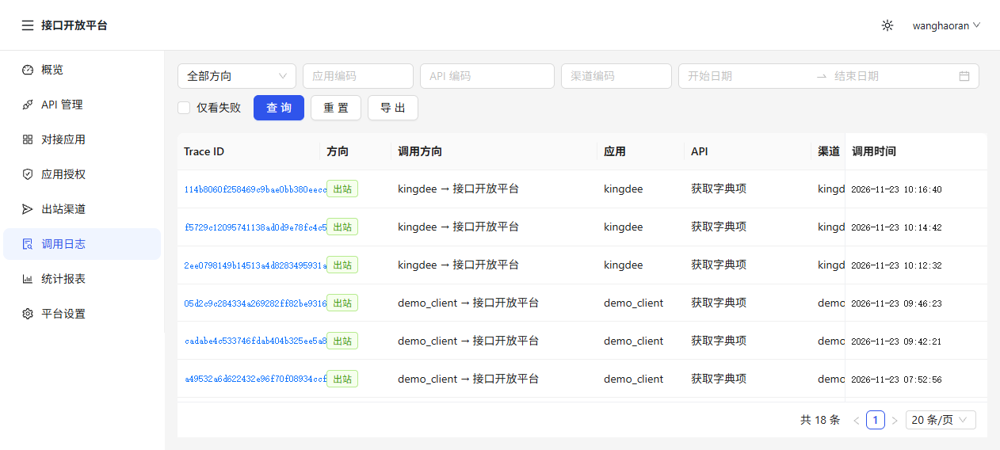
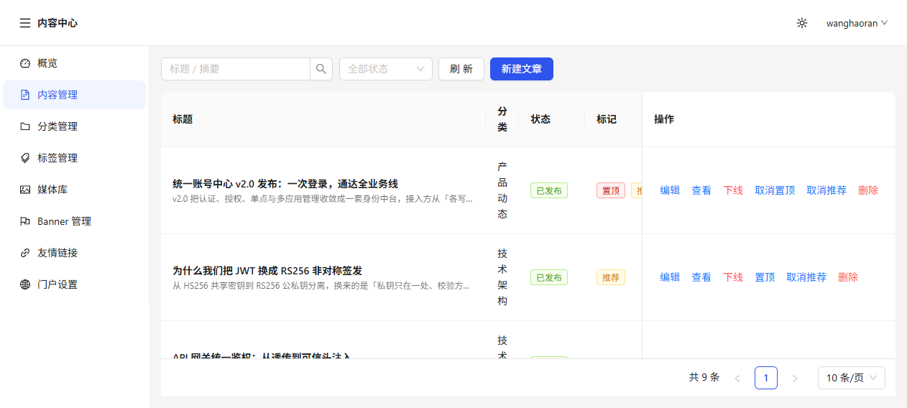

# Polaris 一体化企业平台

前后端一体化仓库。一次 clone 即可拿到完整源码：后端 `polaris-server/`、前端 `polaris-web/`。

## 仓库结构

```text
polaris/
├── README.md            # 本文件：总览与快速入口
├── polaris-server/      # 后端：Java 17 + Spring Boot 3 + Spring Cloud，多模块 Maven
│   └── README.md        # 后端说明：本地部署、生产部署、模块、环境变量、FAQ
└── polaris-web/         # 前端：Vue 3 + TypeScript + Vite，9 个独立应用
    └── README.md        # 前端说明：本地部署、生产部署、应用与端口、FAQ
```

## 界面预览

以下截图均来自生产环境（[polaris-sso.laimengchao.site](https://polaris-sso.laimengchao.site/)），更多页面见 [docs/screenshots/](docs/screenshots/)。

| 统一登录 | 账号中心工作台 | 人力中心-组织树 |
|:---:|:---:|:---:|
|  |  |  |

| 接口开放平台-概览 | 应用授权 | 调用日志 |
|:---:|:---:|:---:|
|  |  |  |

| 内容中心-文章 | 北极星空论坛 | 内容门户 |
|:---:|:---:|:---:|
|  |  |  |

## 快速开始

```bash
git clone https://github.com/crom-lmc/polaris.git
cd polaris
```

- [后端：从 clone 到启动 / 上线](polaris-server/README.md#一从-clone-到启动本地部署) — JDK 17、Maven 3.9+、MySQL、Redis；建库导 SQL、配密钥与环境变量、按序启动服务；生产 jar 发布与 Docker/Nginx。
- [前端：从 clone 到启动 / 上线](polaris-web/README.md#一从-clone-到启动本地部署) — Node.js 20、各应用 `npm ci && npm run dev`；生产 `npm run build` 后发布 dist 到 Nginx。

## 平台能力

平台由 8 个业务域 + 1 个开放平台组成，每个域都有独立的后端服务与前端应用，经 Gateway 统一接入、共享 SSO 登录与 RBAC 权限体系。

| 业务域 | 后端服务（端口） | 前端应用（开发端口） | 核心能力 |
|---|---|---|---|
| 统一账号与 SSO | gateway 9080 / auth 9001 / account 9002 | `polaris-sso-web` (5173) | 登录/验证码/单点登录、RS256 令牌签发与吊销、账号/角色/权限码、应用登记与授权、组织数据范围、审批中心、登录日志 |
| 人力中心 EHR | ehr 9006 | `polaris-ehr-web` (5179) | 组织树、员工档案、合同/司龄/年假、考勤与假勤、招聘、转正离职、审批协同、公告、人力台账 |
| 配置与审批中心 | settings 9007 | `polaris-settings-web` (5180) | 数据字典、单号规则、主数据、审批流程与场景、统一待办已办、站内消息与安全配置 |
| 内容中心 CMS | cms 9004 | `polaris-cms-web` (5177) | 文章草稿/审批/发布、Markdown 编辑、树形栏目、Banner/推荐位、媒体与友链 |
| 内容门户 Portal | portal 9005 | `polaris-portal-web` (5178) | 聚合 CMS 公开内容、统一待办、招聘展示、门户首页与文章详情 |
| 调度中心 Job | job 9008 | `polaris-job-web` (5181) | 任务定义与 Cron、执行器与 Handler、启停/触发、执行日志与失败报警 |
| 论坛 Forum | forum 9009 | `polaris-forum-web` (5182) / `polaris-forum-admin-web` (5183) | 板块/标签/帖子、积分等级徽章、抽奖（九宫格/转盘）与礼品兑换、内容审核与活动运营 |
| **接口开放平台** | openapi 9010（独立库 `polaris_openapi`） | `polaris-openapi-web` (5184) | 第三方 `appCode+appSecret` 换票、接口级授权、入/出站调用、限流防重放、调用日志与统计、出站渠道凭证托管 |

三条横向能力贯穿所有业务域：

- **认证与鉴权**：用户登录由 auth 签发 RS256 令牌，Gateway 验签并查吊销名单；前端经一次性 ticket 换登录态；服务端按权限码 + 组织数据范围双层控制。
- **审批与消息**：settings 提供统一审批流程与站内消息，EHR/CMS 等业务通过回调接入，失败可重试且回调幂等。
- **开放能力**：对外由开放平台统一暴露接口并审计，对内经 `X-Internal-Token` 调用 `/internal/**`，私钥与内部令牌只通过环境变量或 `ENC(...)` 注入。

各模块的完整功能清单见：[后端 README · 五、功能模块](polaris-server/README.md#五功能模块) 与 [前端 README · 四、功能模块](polaris-web/README.md#四功能模块)。

## 约定

- 后端各服务按业务分库；Gateway(9080) 是统一入口。
- 生产 `sql.init.mode=never`，密钥只用环境变量或 `ENC(...)` 注入，绝不入库。
- 新增功能按前后端 README 的「开发规范」执行；迭代文档放仓库外，不纳入 Git。
