# Polaris Server（后端）

Polaris 一体化企业平台后端，提供统一认证、账号与权限、人力管理、配置与审批、内容管理、门户聚合、**接口开放平台**、任务调度、**统一文件服务**、**统一审计中心**和**北极星会（会议室管理）**能力。

技术栈：Java 17 + Spring Boot 3.2.5 + Spring Cloud 2023.0.1 + MyBatis-Plus 3.5.7 + MySQL 5.7+ + Redis。Gateway 是统一入口，MySQL 按业务分库，Redis 用于令牌吊销和缓存。Nacos 配置中心/注册中心均为可选项，本地开发可不安装。

> 本仓库是前后端一体化仓库：`polaris/` 下包含 `polaris-server/`（后端，本文）与 `polaris-web/`（前端，见 [前端 README](../polaris-web/README.md)）。只需 clone 一次即可拿到全部代码。

---

## 一、从 clone 到启动：本地部署

本节面向第一次拿到代码、希望在本机跑通 **SSO + EHR + 接口开放平台** 的开发者。

### 1.1 准备软件

| 软件 | 版本 | 说明 |
|---|---|---|
| JDK | 17 | `java -version` 应为 17 |
| Maven | 3.9.x（推荐） | 本工程 compiler 3.13 需要 Maven 3.9+ |
| MySQL | 5.7+ | 按业务分库，需要建库权限 |
| Redis | 5+ | 默认 `127.0.0.1:6379` |
| Node.js | 20 LTS | 仅前端需要，见前端 README |
| IDEA / Git Bash | 可选 | 用于启动服务与执行脚本 |

不需要 Nacos：保持 `SSO_NACOS_ENABLED=false`、`SSO_NACOS_DISCOVERY=false` 即可。

### 1.2 获取代码

```bash
# 一体化仓库：前后端一次 clone
git clone https://github.com/crom-lmc/polaris.git
cd polaris/polaris-server
```

### 1.3 创建数据库

用有建库权限的 MySQL 账号执行（开放平台、文件服务、审计中心、会议室各自独立库）：

```sql
CREATE DATABASE IF NOT EXISTS sso_ms          DEFAULT CHARACTER SET utf8mb4 COLLATE utf8mb4_general_ci;
CREATE DATABASE IF NOT EXISTS ehr             DEFAULT CHARACTER SET utf8mb4 COLLATE utf8mb4_general_ci;
CREATE DATABASE IF NOT EXISTS settings        DEFAULT CHARACTER SET utf8mb4 COLLATE utf8mb4_general_ci;
CREATE DATABASE IF NOT EXISTS cms             DEFAULT CHARACTER SET utf8mb4 COLLATE utf8mb4_general_ci;
CREATE DATABASE IF NOT EXISTS polaris_job     DEFAULT CHARACTER SET utf8mb4 COLLATE utf8mb4_general_ci;
CREATE DATABASE IF NOT EXISTS polaris_openapi DEFAULT CHARACTER SET utf8mb4 COLLATE utf8mb4_general_ci;
CREATE DATABASE IF NOT EXISTS polaris_file    DEFAULT CHARACTER SET utf8mb4 COLLATE utf8mb4_general_ci;
CREATE DATABASE IF NOT EXISTS polaris_audit   DEFAULT CHARACTER SET utf8mb4 COLLATE utf8mb4_general_ci;
CREATE DATABASE IF NOT EXISTS polaris_meetingroom DEFAULT CHARACTER SET utf8mb4 COLLATE utf8mb4_general_ci;
```

只跑 SSO + EHR 时，先建 `sso_ms`、`ehr`、`settings` 即可；接口开放平台、统一文件服务、统一审计中心、北极星会分别额外需要 `polaris_openapi`、`polaris_file`、`polaris_audit`、`polaris_meetingroom`。

### 1.4 初始化业务库

各服务使用自身 `src/main/resources/` 下的 `schema.sql`、`data.sql`。全新空库先执行 `schema.sql` 再执行 `data.sql`；**已有数据的库不要重复导入全量 data.sql**。以下为在仓库根目录执行的示例：

```bash
# 账号、配置、EHR、CMS、调度
mysql -uroot -p --default-character-set=utf8mb4 sso_ms  < polaris-sso/polaris-sso-account/src/main/resources/schema.sql
mysql -uroot -p --default-character-set=utf8mb4 sso_ms  < polaris-sso/polaris-sso-account/src/main/resources/data.sql
mysql -uroot -p --default-character-set=utf8mb4 settings < polaris-settings/polaris-settings-service/src/main/resources/schema.sql
mysql -uroot -p --default-character-set=utf8mb4 settings < polaris-settings/polaris-settings-service/src/main/resources/data.sql
mysql -uroot -p --default-character-set=utf8mb4 ehr     < polaris-ehr/polaris-ehr-service/src/main/resources/schema.sql
mysql -uroot -p --default-character-set=utf8mb4 ehr     < polaris-ehr/polaris-ehr-service/src/main/resources/data.sql
mysql -uroot -p --default-character-set=utf8mb4 cms     < polaris-cms/polaris-cms-service/src/main/resources/schema.sql
mysql -uroot -p --default-character-set=utf8mb4 cms     < polaris-cms/polaris-cms-service/src/main/resources/data.sql
mysql -uroot -p --default-character-set=utf8mb4 polaris_job < polaris-job/polaris-job-service/src/main/resources/schema.sql
mysql -uroot -p --default-character-set=utf8mb4 polaris_job < polaris-job/polaris-job-service/src/main/resources/data.sql

# 接口开放平台
mysql -uroot -p --default-character-set=utf8mb4 polaris_openapi < polaris-openapi/polaris-openapi-service/src/main/resources/schema.sql
mysql -uroot -p --default-character-set=utf8mb4 polaris_openapi < polaris-openapi/polaris-openapi-service/src/main/resources/data.sql

# 统一文件服务
mysql -uroot -p --default-character-set=utf8mb4 polaris_file < polaris-file/polaris-file-service/src/main/resources/schema.sql
mysql -uroot -p --default-character-set=utf8mb4 polaris_file < polaris-file/polaris-file-service/src/main/resources/data.sql

# 统一审计中心
mysql -uroot -p --default-character-set=utf8mb4 polaris_audit < polaris-audit/polaris-audit-server/src/main/resources/schema.sql
mysql -uroot -p --default-character-set=utf8mb4 polaris_audit < polaris-audit/polaris-audit-server/src/main/resources/data.sql

# 北极星会（会议室管理）
mysql -uroot -p --default-character-set=utf8mb4 polaris_meetingroom < polaris-meeting/polaris-meeting-service/src/main/resources/schema.sql
mysql -uroot -p --default-character-set=utf8mb4 polaris_meetingroom < polaris-meeting/polaris-meeting-service/src/main/resources/data.sql
```

Account 默认 `sql.init.mode=never`，其余服务本地默认 `always`；生产环境必须统一设为 `never`。Account 首次启动可通过 `SSO_ADMIN_USERNAME/PASSWORD/EMAIL` 创建内置管理员（已存在则不重置密码）。

### 1.5 准备 RSA 密钥

```bash
openssl genpkey -algorithm RSA -out jwt-private.pem -pkeyopt rsa_keygen_bits:2048
openssl rsa -pubout -in jwt-private.pem -out jwt-public.pem
```

```powershell
$env:SSO_JWT_PRIVATE_KEY = Get-Content -Raw "C:\path\to\jwt-private.pem"
$env:SSO_JWT_PUBLIC_KEY  = Get-Content -Raw "C:\path\to\jwt-public.pem"
```

auth 保管私钥签发 RS256，Gateway 只持有公钥验签；两者必须匹配。私钥绝不入库。

### 1.6 配置本地环境变量

以下示例在 PowerShell 当前窗口设置，仅对该窗口启动的进程有效；IDEA 启动时填到 Run Configuration 的 Environment variables。

```powershell
$env:SSO_NACOS_ENABLED = "false"
$env:SSO_NACOS_DISCOVERY = "false"

# Account 数据库（已手工初始化，保持 never）
$env:SSO_DB_URL = "jdbc:mysql://127.0.0.1:3306/sso_ms?useUnicode=true&characterEncoding=utf8&serverTimezone=Asia/Shanghai&useSSL=false"
$env:SSO_DB_USER = "your_db_user"
$env:SSO_DB_PASSWORD = "your_db_password"
$env:SSO_SQL_INIT_MODE = "never"

# EHR / Settings 数据库
$env:EHR_DB_URL = "jdbc:mysql://127.0.0.1:3306/ehr?useUnicode=true&characterEncoding=utf8&serverTimezone=Asia/Shanghai&useSSL=false"
$env:EHR_DB_USER = "your_db_user"; $env:EHR_DB_PASSWORD = "your_db_password"
$env:SETTINGS_DB_URL = "jdbc:mysql://127.0.0.1:3306/settings?useUnicode=true&characterEncoding=utf8&serverTimezone=Asia/Shanghai&useSSL=false"
$env:SETTINGS_DB_USER = "your_db_user"; $env:SETTINGS_DB_PASSWORD = "your_db_password"

# 接口开放平台
$env:OPENAPI_DB_URL = "jdbc:mysql://127.0.0.1:3306/polaris_openapi?useUnicode=true&characterEncoding=utf8&serverTimezone=Asia/Shanghai&useSSL=false&createDatabaseIfNotExist=true"
$env:OPENAPI_DB_USER = "your_db_user"; $env:OPENAPI_DB_PASSWORD = "your_db_password"
$env:OPENAPI_SQL_INIT_MODE = "never"
$env:OPENAPI_CHANNEL_KEY = "replace-with-32-byte-aes-key"

# 统一文件服务 / 统一审计中心
$env:FILE_DB_URL = "jdbc:mysql://127.0.0.1:3306/polaris_file?useUnicode=true&characterEncoding=utf8&serverTimezone=Asia/Shanghai&useSSL=false"
$env:FILE_DB_USER = "your_db_user"; $env:FILE_DB_PASSWORD = "your_db_password"
$env:FILE_SIGN_SECRET = "replace-with-a-long-random-file-sign-secret"   # PRIVATE 文件 HMAC 签名密钥
$env:AUDIT_DB_URL = "jdbc:mysql://127.0.0.1:3306/polaris_audit?useUnicode=true&characterEncoding=utf8&serverTimezone=Asia/Shanghai&useSSL=false"
$env:AUDIT_DB_USER = "your_db_user"; $env:AUDIT_DB_PASSWORD = "your_db_password"

# 北极星会（会议室管理）
$env:MEETING_DB_URL = "jdbc:mysql://127.0.0.1:3306/polaris_meetingroom?useUnicode=true&characterEncoding=utf8&serverTimezone=Asia/Shanghai&useSSL=false"
$env:MEETING_DB_USER = "your_db_user"; $env:MEETING_DB_PASSWORD = "your_db_password"
$env:SSO_MEETING_APP_SECRET = "replace-with-meeting-app-secret"

# 服务间内部令牌：所有涉及内部调用的服务必须一致
$env:SSO_INTERNAL_TOKEN = "replace-with-a-long-random-token"

# 业务应用换票密钥：必须与账号中心应用登记中的 appSecret 一致
$env:EHR_APP_SECRET = "replace-with-ehr-app-secret"
$env:SETTINGS_APP_SECRET = "replace-with-settings-app-secret"

# 初始管理员
$env:SSO_ADMIN_USERNAME = "admin"
$env:SSO_ADMIN_PASSWORD = "replace-with-a-local-admin-password"
$env:SSO_ADMIN_EMAIL = "admin@example.local"
```

Redis 默认无密码、`127.0.0.1:6379`。单实例开发可用 `SSO_REVOCATION_STORE=memory`，多实例/生产用 `redis`。完整可配置项以各服务 `application.yml` 为准。

### 1.7 编译

```bash
mvn clean package -DskipTests                                             # 全部模块
mvn -pl polaris-openapi/polaris-openapi-service -am -DskipTests package   # 只打开放平台及依赖
mvn -DskipTests compile                                                   # 只检查编译
```

### 1.8 启动顺序

| 顺序 | 服务 | 端口 | SSO+EHR 是否必需 |
|---:|---|---:|---|
| 1 | MySQL、Redis | — | 必需 |
| 2 | Account、Settings | 9002 / 9007 | 必需 |
| 3 | Auth | 9001 | 必需 |
| 4 | EHR | 9006 | 使用 EHR 时必需 |
| 5 | Gateway | 9080 | 必需，前端统一入口 |
| 6 | 接口开放平台 OpenAPI | 9010 | 使用开放平台时必需 |
| 7 | CMS、Portal、Job、Forum | 9004/9005/9008/9009 | 按业务需要 |
| 8 | 统一文件服务 File | 9011 | 使用附件/水印时必需 |
| 9 | 统一审计中心 Audit | 9012 | 生产环境必备（异步接收审计与系统日志） |
| 10 | 北极星会（会议室管理）Meeting | 9013 | 使用会议室时必需 |

IDEA 启动：运行对应 `*Application` 启动类，每个 Run Configuration 配置相同环境变量。命令行启动：每个服务独立终端，`java -jar <target 下的 jar>`。开放平台启动类为 `OpenapiApplication`，产物 `polaris-openapi/polaris-openapi-service/target/openapi-service.jar`。

### 1.9 验证

```text
http://127.0.0.1:9001/actuator/health
http://127.0.0.1:9002/actuator/health
http://127.0.0.1:9006/actuator/health
http://127.0.0.1:9007/actuator/health
http://127.0.0.1:9010/actuator/health   # 接口开放平台
http://127.0.0.1:9011/actuator/health   # 统一文件服务
http://127.0.0.1:9012/actuator/health   # 统一审计中心
http://127.0.0.1:9013/actuator/health   # 北极星会（会议室管理）
http://127.0.0.1:9080/actuator/health
```

按前端 README 启动前端后，在账号中心确认：管理员可登录、各应用已登记且 `base_url` 与前端 origin 一致、`*_APP_SECRET` 与后端匹配、账号具备角色/权限/数据范围。开放平台还需在「对接应用」登记第三方应用并授权接口，第三方用 `app_code + app_secret` 调 `/api/open/token` 换票。

---

## 二、从 clone 到上线：生产部署

生产环境约定：源码位于 `/opt/polaris/src/polaris/`（本仓库），产物在 `/opt/polaris/jars/`（后端 jar）与 `/opt/polaris/www/`（前端站点），Nginx 负责域名与 HTTPS，MySQL/Redis 用 Docker Compose 或托管实例。

### 2.1 首次上线准备

1. 安装 JDK 17、Maven 3.9+、Node.js 20、Docker、Nginx、MySQL 5.7、Redis。
2. 在服务器 clone 一体化仓库：

```bash
sudo mkdir -p /opt/polaris/src && sudo chown -R $USER /opt/polaris
git clone https://github.com/crom-lmc/polaris.git /opt/polaris/src/polaris
```

3. 按 1.3 / 1.4 建库并导入基线（生产 `sql.init.mode=never`，不走启动自动初始化）。
4. 准备密钥文件（放在仓库外、受限权限）：RSA 私钥/公钥、内部令牌、`OPENAPI_CHANNEL_KEY`、开放平台签名密钥、数据库密码。用环境变量或 `ENC(...)` 注入，绝不写进仓库。
5. 复制并修改编排配置：`deploy/docker-compose.yml`、`deploy/.env.example` → `.env`、`deploy/nginx/` 下的站点模板，核对域名、路径、端口、证书。

### 2.2 构建与发布后端

```bash
cd /opt/polaris/src/polaris/polaris-server
mvn -B -DskipTests package
sudo mkdir -p /opt/polaris/jars
sudo install -m 644 polaris-sso/polaris-sso-gateway/target/polaris-sso-gateway-1.0.0.jar /opt/polaris/jars/sso-gateway.jar
sudo install -m 644 polaris-sso/polaris-sso-auth/target/polaris-sso-auth-1.0.0.jar    /opt/polaris/jars/sso-auth.jar
sudo install -m 644 polaris-sso/polaris-sso-account/target/polaris-sso-account-1.0.0.jar /opt/polaris/jars/sso-account.jar
sudo install -m 644 polaris-settings/polaris-settings-service/target/settings-service.jar /opt/polaris/jars/settings.jar
sudo install -m 644 polaris-ehr/polaris-ehr-service/target/ehr-service.jar /opt/polaris/jars/ehr.jar
sudo install -m 644 polaris-openapi/polaris-openapi-service/target/openapi-service.jar /opt/polaris/jars/openapi-service.jar
sudo install -m 644 polaris-file/polaris-file-service/target/file-service.jar       /opt/polaris/jars/file-service.jar
sudo install -m 644 polaris-audit/polaris-audit-server/target/audit-server.jar     /opt/polaris/jars/audit-server.jar
sudo install -m 644 polaris-meeting/polaris-meeting-service/target/meeting-service.jar /opt/polaris/jars/meeting-service.jar
# 其余 cms / portal / job / forum 同理
```

> 仓库内提供了 `scripts/server-deploy.sh`（一键拉代码→构建→发布 jar 与前端 dist→重启）与 `scripts/server-prep.sh`，但脚本里的源码路径仍是旧的 `/opt/polaris/src/{polaris-server,polaris-web}` 双目录布局。使用本一体化仓库时，请把脚本中的 `SRC/polaris-server`、`SRC/polaris-web` 改为 `SRC/polaris/polaris-server`、`SRC/polaris/polaris-web`，再执行。

### 2.3 发布前端

每个前端应用独立构建并发布到 `/opt/polaris/www/<站点>/`：

```bash
cd /opt/polaris/src/polaris/polaris-web/polaris-openapi-web
npm ci && npm run build
sudo mkdir -p /opt/polaris/www/openapi
sudo cp -r dist/. /opt/polaris/www/openapi/
```

其他应用（sso / ehr / cms / portal / settings / job / forum / file / audit / meeting）同样处理。注意 `server-deploy.sh` 的 `build_site` 只覆盖 8 个站点，openapi / file / audit / meeting 需单独发布；域名与环境注入详见 [前端 README](../polaris-web/README.md)。

### 2.4 重启与验证

```bash
docker compose -f /opt/polaris/docker-compose.yml restart   # 或按需重启单个容器
sudo nginx -t && sudo nginx -s reload
curl -fsS https://<域名>/actuator/health
```

发版自检清单：健康端点、Gateway 路由、SSO 登录换票、权限与数据范围、审批回调、调度执行器心跳、开放平台换票与接口调用、各前端子路由刷新与静态资源。生产必须 HTTPS，`base_url`/前端 origin/实际访问地址三者一致，业务服务端口不直接暴露公网。

### 2.5 发布注意事项

- 全新库用基线初始化，存量库升级走单独审核的迁移 SQL；生产 `sql.init.mode` 必须为 `never`。
- 私钥、配置主密钥、内部令牌、appSecret、`OPENAPI_CHANNEL_KEY` 用密钥管理系统或受限文件注入。
- auth 与 Gateway 使用匹配 RSA 密钥对；所有内部调用方 `SSO_INTERNAL_TOKEN` 一致。
- 多实例 auth 用 Redis 吊销存储；上传目录、日志、数据库需持久化与备份。

---

## 三、技术栈与整体架构

| 分类 | 技术 |
|---|---|
| 运行环境 | Java 17、Maven 3.9+ |
| 核心框架 | Spring Boot 3.2.5、Spring Cloud 2023.0.1 |
| 微服务组件 | Spring Cloud Alibaba 2023.0.1.0、Spring Cloud Gateway、OpenFeign |
| 数据访问 | MyBatis-Plus 3.5.7、MySQL 5.7+ |
| 缓存与会话 | Redis |
| 认证 | OAuth2 授权码/一次性 ticket、RS256 JWT |
| 配置中心 | Nacos，可选，默认关闭 |
| 构建 | Maven 多模块、Spring Boot 可执行 jar |

```text
浏览器 / 各前端应用 / 第三方系统
        │
        ▼
polaris-sso-gateway :9080
        │  RS256 验签、令牌吊销检查、路由、可信用户头
        ├──────────────► sso-auth :9001        登录、签发/刷新/吊销令牌
        ├──────────────► sso-account :9002     账号、角色、权限、应用
        ├──────────────► cms :9004 / portal :9005 / ehr :9006
        ├──────────────► settings :9007 / job :9008 / forum :9009
        ├──────────────► file :9011（统一文件服务，独立库 polaris_file）
        ├──────────────► audit :9012（统一审计中心，独立库 polaris_audit）
        ├──────────────► meeting :9013（北极星会，独立库 polaris_meetingroom）
        └──────────────► (内部服务) X-Internal-Token

第三方系统 ──appCode+appSecret 换票──► polaris-openapi :9010 ──Bearer Token──► 开放接口
                                          │
                                          └──平台内部服务──► 出站渠道（邮件等）
```

认证链路：用户登录 → auth 用私钥签发 RS256 access/refresh token → 业务应用用一次性 ticket 换登录态 → 前端请求经 Gateway 验签/查吊销 → 可信用户头传给业务服务 → `@Permit` 校验权限码、数据权限按组织过滤。

---

## 四、仓库结构

```text
polaris/
├── polaris-server/                  # 后端（本文）
│   ├── pom.xml                      # Maven 父工程与统一依赖版本
│   ├── polaris-common/              # 公共响应、异常、安全上下文、加解密
│   ├── polaris-sso/                 # gateway :9080 / auth :9001 / account :9002 / client
│   ├── polaris-cms/                 # 内容服务 :9004
│   ├── polaris-portal/              # 门户聚合 :9005
│   ├── polaris-ehr/                 # 人力服务 :9006
│   ├── polaris-settings/            # 配置/审批/消息 :9007 + client
│   ├── polaris-job/                 # 调度中心 :9008 + client
│   ├── polaris-forum/               # 论坛服务 :9009
│   ├── polaris-openapi/             # 接口开放平台 :9010（独立库 polaris_openapi）
│   ├── polaris-file/                # 统一文件服务 :9011（独立库 polaris_file）+ client
│   ├── polaris-audit/               # 统一审计中心 :9012（独立库 polaris_audit）+ client
│   ├── polaris-meeting/             # 北极星会（会议室管理）:9013（独立库 polaris_meetingroom）
│   ├── polaris-nacos/               # 可选 Nacos 配置与密钥模板
│   ├── deploy/                      # Docker Compose、Nginx、初始化 SQL
│   └── scripts/                     # 构建、发布、备份、配置导入脚本
└── polaris-web/                     # 前端（见前端 README）
```

`polaris-common` 与各 `*-client` 是依赖模块，不单独启动。

---

## 五、功能模块

### 5.1 Gateway：统一网关

对外监听 `9080`，是前端与第三方唯一入口，业务服务端口不直接暴露公网。核心职责：

- **路由转发**：按路径前缀转发到 auth/account/ehr/cms/portal/settings/job/forum/openapi，默认直连 `127.0.0.1:9001~9010`，可选 Nacos Discovery 服务发现。
- **令牌校验**：用 RSA 公钥验 RS256 签名，检查 Redis 吊销名单， denied 令牌直接 401。
- **可信头注入**：解析令牌后把用户 ID/账号/权限码写成可信请求头传给下游，业务服务不再自行验签。
- **白名单放行**：登录、验证码、开放平台换票等公开路径免鉴权，其余一律经鉴权链。

### 5.2 SSO：统一认证与账号中心

**auth :9001（5 个 Controller）** — 认证与令牌中枢：

- 账号/邮箱登录、图形验证码、连续失败锁定与解锁。
- RS256 access/refresh 令牌签发、刷新、吊销；吊销名单写 Redis。
- 跨应用一次性 ticket 换票：前端拿 ticket 换取本应用登录态，ticket 只能用一次。
- 内部接口 `/internal/**` 供各业务服务换取用户信息，凭 `X-Internal-Token` 调用。
- 微信绑定等第三方账号关联。

**account :9002（13 个 Controller）** — 主数据与权限中枢：

- 账号 `Account`、角色 `Role`、权限码 `Permission` 的增删改查与授权关系维护。
- 应用登记 `Application`：登记各前端应用的 `base_url` 与 appSecret，作为 SSO 换票凭据。
- 组织实体 `InternalEntity`、数据范围授权：按组织维度限制可见数据，空范围按空集处理。
- 审批中心 `ApprovalCenter`：应用接入/权限申请类审批。
- 概览 `Overview`、当前用户 `CurrentAccount`、登录日志、初始管理员与密码策略。
- 对开放平台提供 `InternalOpenapi`：按应用 ID 签发 client 用途令牌（见 5.7）。

### 5.3 EHR：人力中心

共 33 个 Controller，是覆盖面最广的业务模块。按能力分组：

- **组织与员工**：`AdminOrg` 组织树、`AdminEmployee`/`EmployeeProfile` 员工档案（敏感字段脱敏）、`EmployeeLookup` 人员检索、`Attachment` 附件。
- **合同与假期**：`Contract` 合同、`AdminSeniority` 司龄、`AnnualLeave`/`LeaveQuota`/`LeaveRule` 年假与假期规则、`WorkCalendar` 工作日历。
- **考勤假勤**：`Attendance` 打卡、`AttendanceDaily` 日报、`AttendanceRule` 规则、`AttendanceCorrection` 补卡、`AttendanceMock` 模拟数据。
- **请假与异动**：`AdminLeave`/`Leave` 请假、`MyRegularize`/`MyResign` 转正离职、`EmpChangeApproval` 异动审批。
- **招聘**：`Recruit`/`PublicRecruit` 社招与公开职位门户。
- **协同与台账**：`Approval` 审批、`AdminAnnouncement`/`Announcement` 公告、`Reminder` 提醒、`HrLedger` 人力台账、`Dashboard` 指标、`ImportExport` 模板导入与 Excel 导出、`AuditLog` 审计日志。
- **内部接口**：`InternalOrg`/`InternalEntity` 供开放平台与 settings 查询组织和人员，`InternalApprovalCallback` 接收审批回调。

权限模型为「功能权限 + 组织数据权限」双层，数据范围在服务端 SQL 层执行，前端隐藏按钮不替代鉴权。

### 5.4 Settings：配置、审批与消息中心

19 个 Controller，提供全平台共享的基础设施能力：

- **基础数据**：`AdminDict`/`InternalDict` 数据字典类型与字典项、`AdminCodeRule`/`InternalCodeRule` 单号规则、`AdminBizData`/`InternalBizData` 主数据、`AdminEmbedPoint`/`InternalEmbedPoint` 嵌入点、`AdminBizPoint` 业务点位。
- **审批引擎**：`AdminApproval` 审批模板/流程/场景/消息配置、`Approval` 统一待办已办我发起、`Callback` 业务回调（幂等）、`NoticeConfig` 通知配置。
- **消息**：`MeNotice`/`AdminNotice` 站内消息，可对接 SMTP 发邮件。
- **安全配置**：`AdminSecurity` 初始密码策略、复杂度、失败锁定、会话设置。
- **对外接口**：`PublicReference` 公开引用数据、`SsoExchange` SSO 换票、`InternalApproval`/`InternalNotice` 供其他服务复用审批与消息能力。

### 5.5 CMS / Portal

**CMS（12 个 Controller）**：`AdminArticle` 文章草稿/提交审批/发布/下架、Markdown 编辑与安全清洗；`AdminTaxonomy` 树形栏目与标签；`AdminBanner` 门户 Banner/推荐位、`AdminPortalLayout` 门户布局；`AdminMedia`/`AdminFriendLink` 媒体库与友链；`PublicContent` 公开内容供门户与开放平台读取；`InternalApprovalCallback` 审批回调。

**Portal（3 个 Controller）**：无独立业务库，聚合 CMS 公开内容、settings 待办与 EHR 招聘信息，提供门户首页、文章详情、招聘列表与职位详情。

### 5.6 Job / Forum

**Job（6 个 Controller）**：`AdminJob` 任务定义与 Cron 表达式、启停与手工触发；`AdminExecutor` 执行器注册与心跳、`AdminAuth` 执行器鉴权；`AdminLog` 执行日志与失败原因；`AdminAlarm` 失败报警规则（复用 settings 消息）；`InternalJob` 供其他服务触发任务。

**Forum（16 个 Controller）**：`Forum`/`AdminForum` 板块与帖子、`PublicForum` 公开内容、`Draft` 草稿、`Attachment` 附件、`Notification` 通知；`Level`/`ExperienceRule`/`AdminExperienceRule`/`AdminLevel`/`Badge`/`AdminBadge` 等级、经验与徽章；`Reward` 积分兑换与抽奖奖励、`Poll` 投票；`Overview`/`Reports` 运营看板；`InternalMember` 会员信息内部接口。详情见前端论坛应用。

### 5.7 接口开放平台（OpenAPI）

独立服务 `polaris-openapi :9010`（11 个 Controller），独立库 `polaris_openapi`，管理端为前端 `polaris-openapi-web`（:5184）。定位：**第三方系统通过标准协议调用平台能力（入站接口），以及平台内部服务调用外部渠道（出站渠道）**。注意这里的入/出站按**数据流向**定义：第三方调我们、平台返回数据给对方 = 出站；我们调第三方、对方返回数据给平台 = 入站。

管理端界面（生产实测截图）：

| 概览 | 应用授权（按接口粒度） | 调用日志 |
|:---:|:---:|:---:|
| 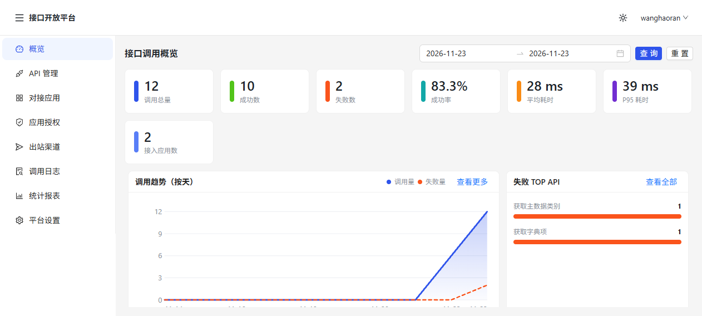 | 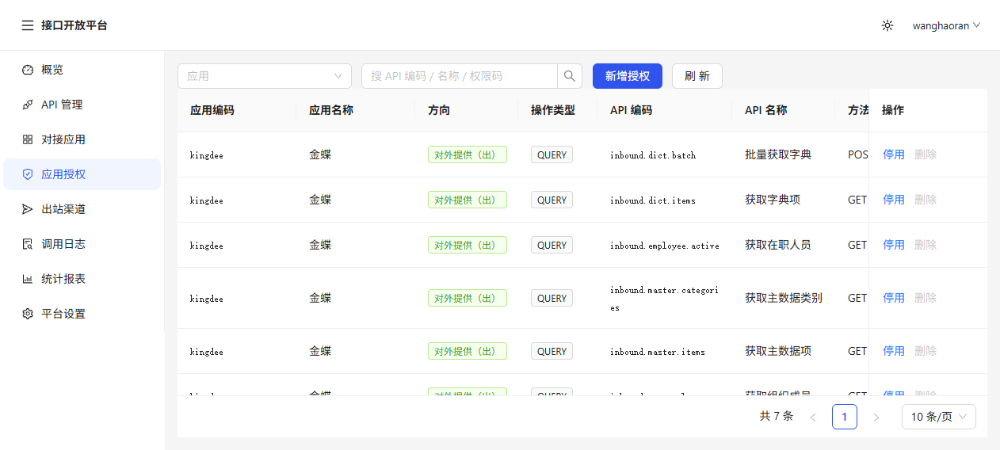 | 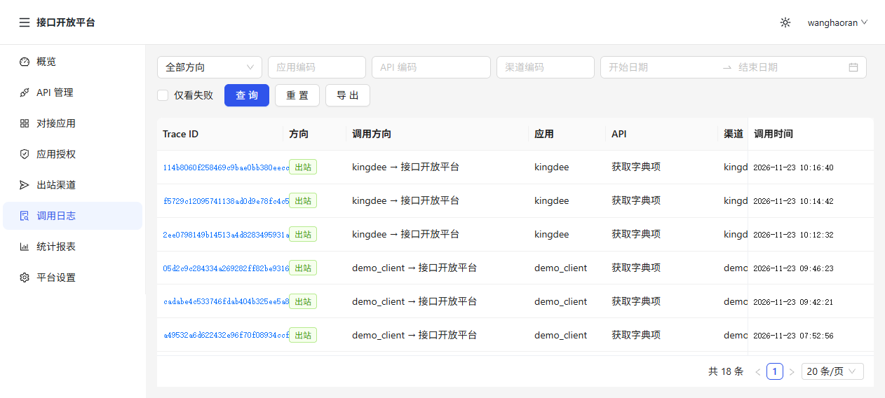 |

**公开接口（`OpenapiController`）**

- `POST /api/open/token`：第三方用 `app_code + app_secret` 换票。openapi 本地校验应用状态与密钥摘要，再走内部接口请 sso-auth 签发令牌——openapi **不自建签发体系**，全平台只有 auth 持有 RS256 私钥。
- 令牌 `sub` 为应用数字 ID、`client_app_code=appCode`、`purpose=client_app`、`perms` 为授权的接口编码列表；有效期由 `OPENAPI_TOKEN_TTL_SECONDS` 配置，过期后用同样凭据重新换票，无 refresh token。
- 入站业务接口：`GET /api/open/v1/dict/{typeCode}/items`、`POST /api/open/v1/dict/batch`、`/employees/active`、`/master/categories`、`/master/{type}/items`、`/orgs/tree`、`/orgs/{id}/employees`。经 nonce + 时间戳防重放、限流、接口级鉴权后，内部调用 settings/ehr 取数。

**管理端接口（`/api/open/admin/**`，SSO 用户令牌 + 权限码访问）**

| Controller | 能力 |
|---|---|
| `AppAdmin` | 对接应用 CRUD、启停、IP 白名单、新增/重置/查看应用密钥 |
| `AuthzAdmin` | 按接口粒度授权/撤销/启停，授权列表 |
| `EndpointAdmin` | 开放接口目录注册与维护（方向、操作类型、权限码、限流、幂等、状态） |
| `ChannelAdmin` | 出站渠道配置（鉴权方式、超时、重试、允许应用、凭证托管） |
| `LogAdmin` | 调用日志查询与导出（Trace ID、方向、应用/接口/渠道、状态、耗时） |
| `StatAdmin` | 概览指标、调用趋势、失败 TOP、应用与接口排行 |
| `SettingAdmin` | 令牌有效期、签名容差、限流等全局参数 |
| `Me` / `SsoExchange` | 管理端当前用户与 SSO 换票 |

**核心机制**

- **对接应用**：`app_code` + 应用密钥，SHA-256 摘要用于验签、`app_secret_plain` 明文列仅供管理端「查看密钥」；启停与 IP 白名单控制接入。
- **应用授权**：`api_client_app_permission` 唯一键 `(app_code, api_code)`，按接口粒度独立授权；停用/删除单个接口不联动，启用状态的接口不能删除；授权编码写入令牌 `perms`，旧 `perm_code` 令牌兼容放行。
- **出站渠道**：`api_outbound_channel` 配置目标渠道（目前邮件 SMTP），第三方口令用 AES-GCM 加密（`OPENAPI_CHANNEL_KEY`），适配器 SPI 便于扩展；非幂等接口自动把重试降为 0，避免重复投递。
- **日志与统计**：`api_call_log` 记录脱敏调用日志，支持概览/趋势/失败 TOP/排行；前端展示的「出站/入站」按上述数据流向语义。

数据表：`api_open_endpoint`、`api_call_log`、`api_open_setting`、`api_outbound_channel`、`api_client_app`、`api_client_app_permission`。第三方接入的完整调用示例（换票、Bearer Token 调用、错误码说明）见项目目录下的迭代文档 `openapi-platform-design.md`（迭代文档放仓库外，不纳入 Git）。

### 5.8 统一文件服务（File）

独立服务 `polaris-file :9011`，独立库 `polaris_file`，管理端为前端 `polaris-file-web`（:5185）。定位：**全平台附件、合同、档案的统一存储与访问入口**，业务服务通过 `polaris-file-client` 的 `FileApi`（`/internal/files/**`）调用，业务表只存 `file_id`，不自建附件表、不另存 URL。

管理端界面（生产实测，白天模式，每个菜单一张）：

| 概览 | 文件管理 | 回收站 |
|:---:|:---:|:---:|
| 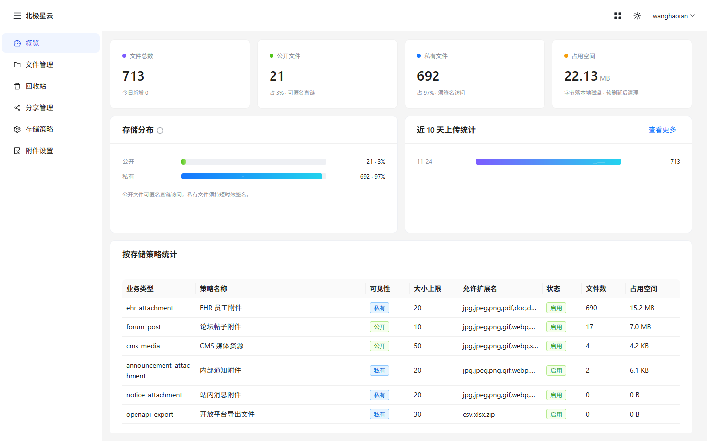 | 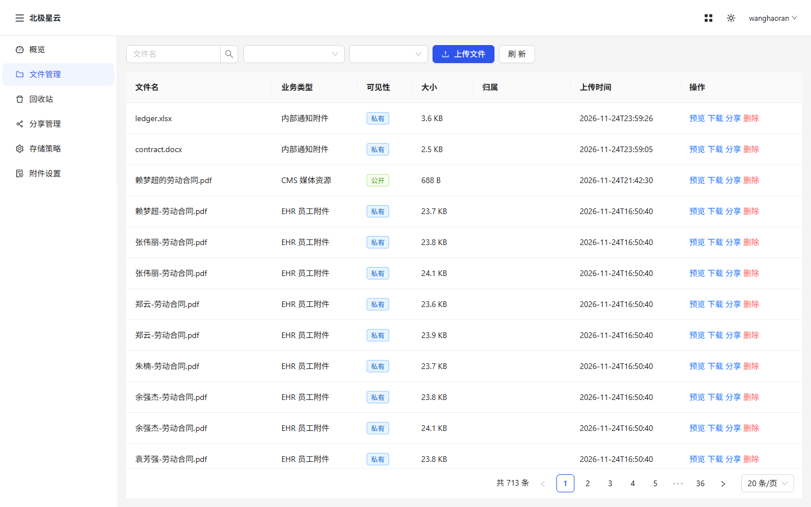 | 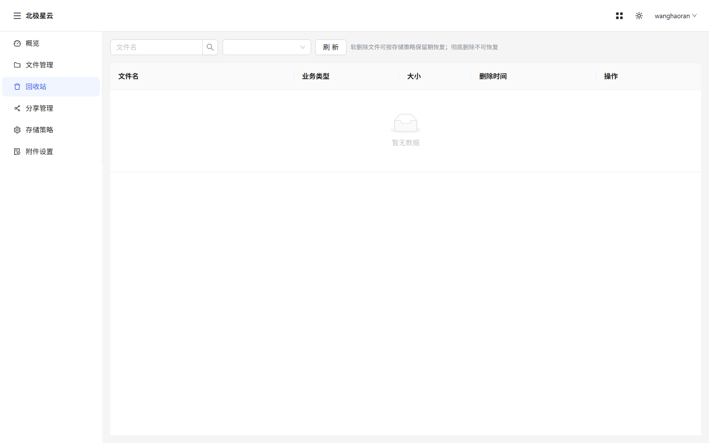 |

| 分享管理 | 存储策略 | 附件设置 |
|:---:|:---:|:---:|
| 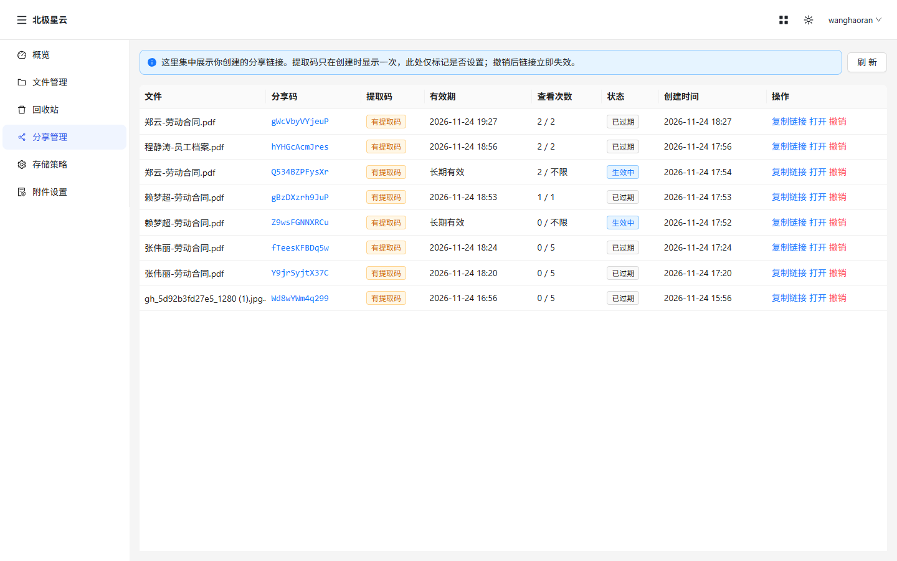 | 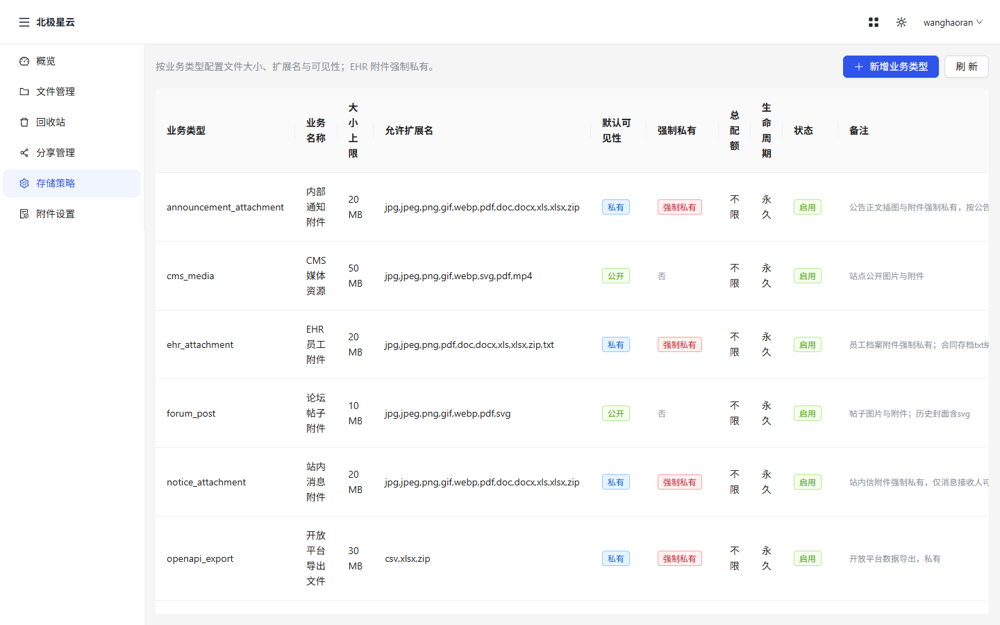 | 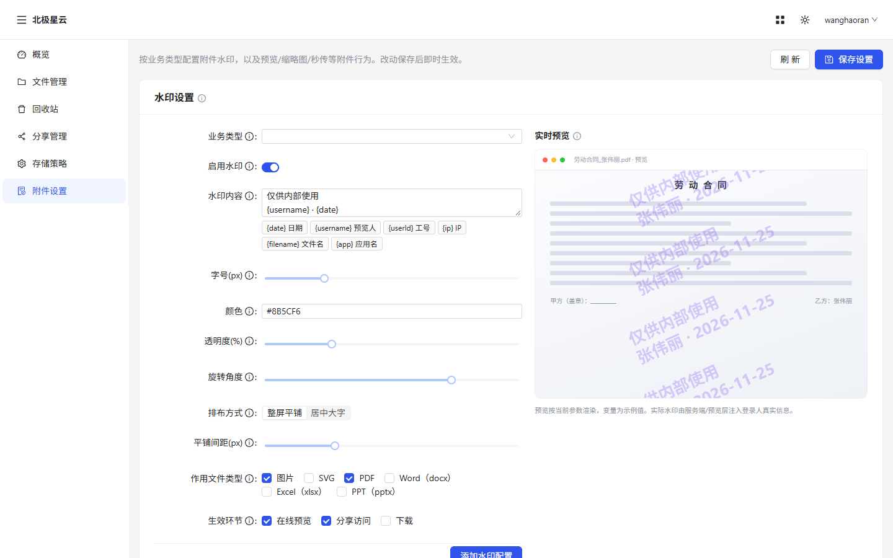 |

- **对象与访问**：`file_object`/`file_storage_policy`/`file_alias` 三张核心表；PUBLIC 文件直链访问，PRIVATE 文件走 HMAC 签名 URL（`FILE_SIGN_SECRET`），签名 TTL 可配且有上限。
- **能力**：秒传（哈希去重）、分片上传、回收站（标记删除与恢复）、分享（提取码 + 有效期/次数）、配额（上传前校验）、在线预览（图片/PDF）。
- **水印**：图片、PDF、SVG、DOCX/XLSX/PPTX 全类型覆盖，**下载链路同样加水印**，不只加在预览；水印内容与生效环节在「附件设置」按业务类型配置，改动即时生效。
- **接入纪律**：附件上传前校验配额与扩展名/魔数；PRIVATE 下载必须走签名接口；新业务表只存 `file_id`。

### 5.9 统一审计中心（Audit）

独立服务 `polaris-audit :9012`，独立库 `polaris_audit`，管理端为前端 `polaris-audit-web`（:5186）。定位：**全平台审计事件与系统日志的统一归集、检索与合规出口**。审计上报异步且失败只 warn，绝不回滚业务。

管理端界面（生产实测，白天模式，每个菜单一张）：

| 概览 | 审计事件 | 登录审计 |
|:---:|:---:|:---:|
| 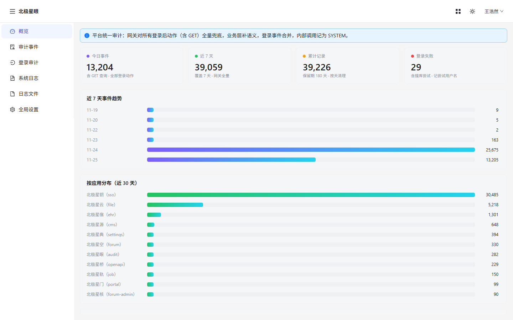 | 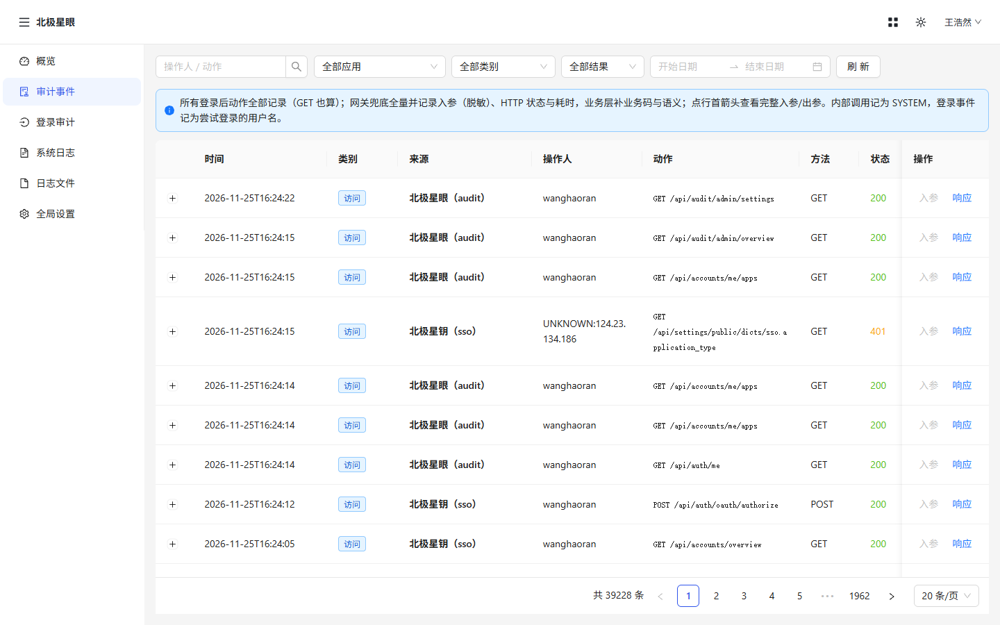 | 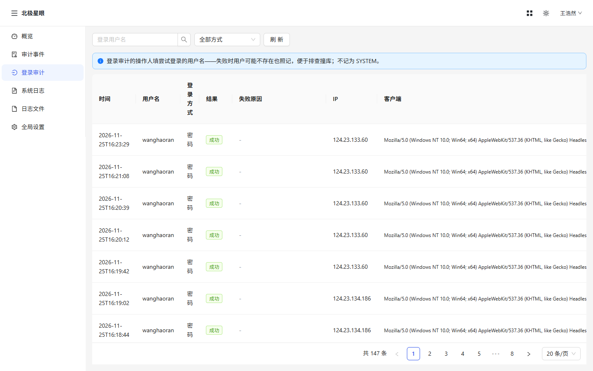 |

| 系统日志 | 日志文件 | 全局设置 |
|:---:|:---:|:---:|
| 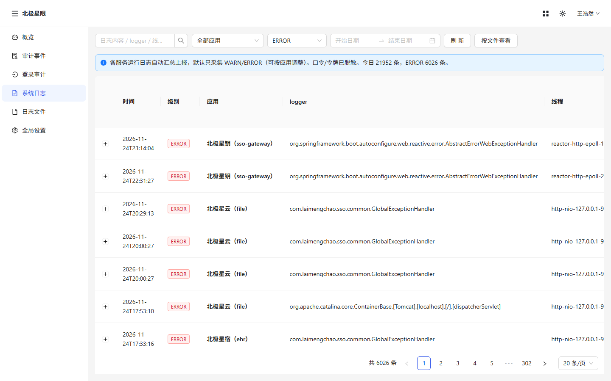 | 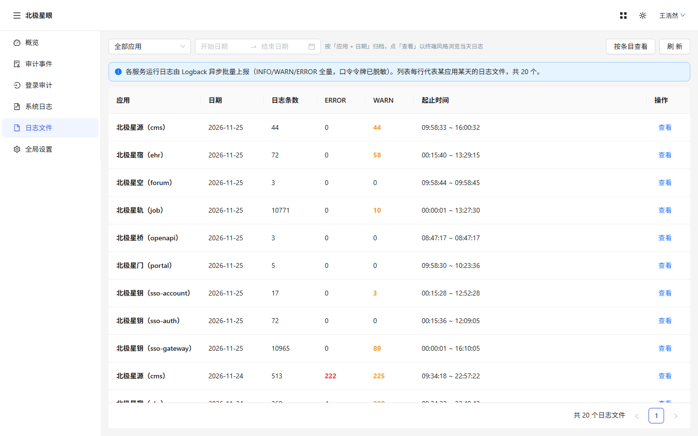 | 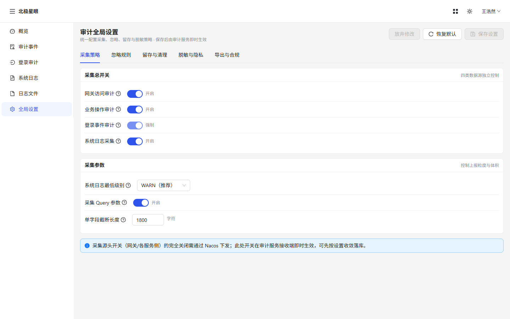 |

- **采集链路**：Gateway `JwtAuthFilter` → `AuditReporter`（WebClient 异步）全量兜底，含 GET（只采 query 串并脱敏，不采 JSON body）；POST/PUT/PATCH/DELETE 由业务侧 `AuditLogAspect` 补记详情。
- **合规下限**：LOGIN / SENSITIVE 事件强制留库，登录事件记**尝试登录的用户名**（失败也记）；有主体记 USER，无主体内部调用记 SYSTEM；匿名 `/public/**` 不在审计范围。
- **系统日志**：由 common 的 Logback Appender 采集 WARN/ERROR 异步落 `system_log`；audit 自身关闭采集（`polaris.system-log.enabled=false`）防递归。
- **全局设置**：采集开关、忽略规则、留存清理、脱敏与隐私、导出合规五个分区，每项均有真实代码引用；无实际功能的配置项不保留。生产 `AUDIT_SQL_INIT_MODE=never`，新表须手工执行 schema。
- **导出**：`GET /api/audit/admin/events/export` 导出 CSV，每次导出强制记一条 SENSITIVE 留痕，不提供关闭开关；权限码 `audit:events:export` 四联动。

### 5.10 北极星会（Meeting）

独立服务 `polaris-meeting :9013`，独立库 `polaris_meetingroom`，管理端为前端 `polaris-meeting-web`（:5187，生产域名 `https://poraris-meeting.laimengchao.site/`）。定位：**全员会议室预定 + 行政房间台账**，并作为新增独立业务应用的接入模板，跑通网关、SSO、权限码、字典、埋点、文件、审计与调度全链路。

管理端界面（生产实测，白天模式，按菜单）：

| 概览 | 位置维护 | 会议室维护 |
|:---:|:---:|:---:|
| 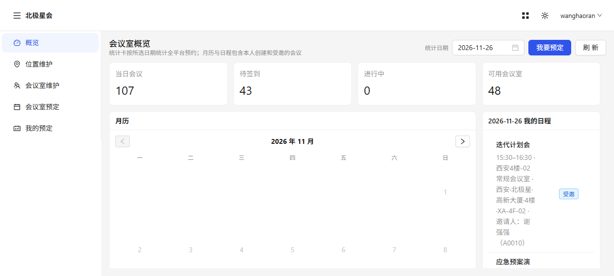 | 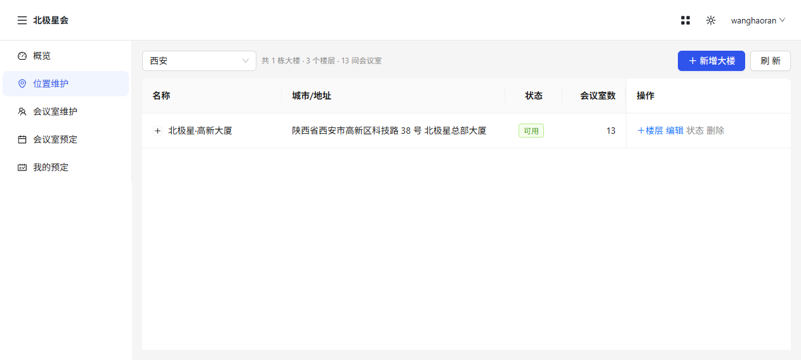 | 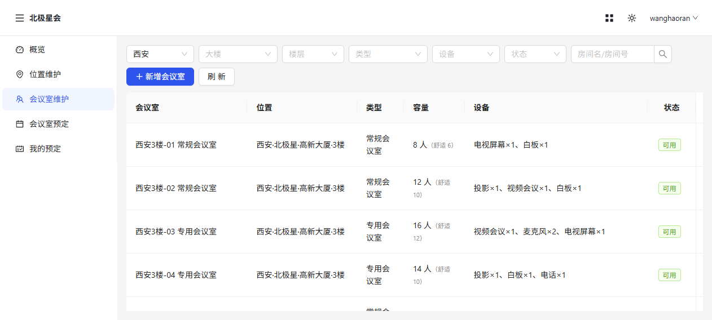 |

| 会议室预定 | 我的预定 |
|:---:|:---:|
| 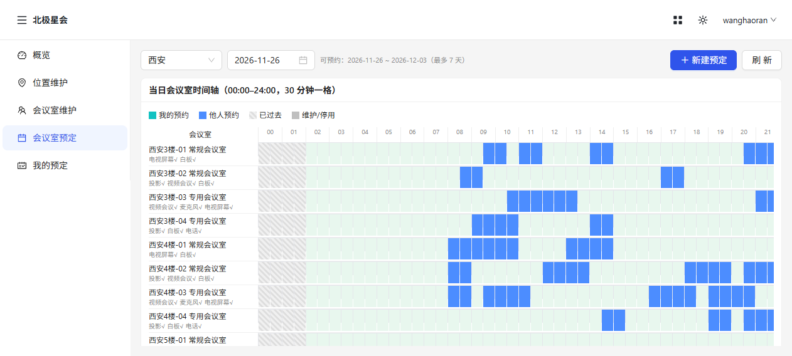 | 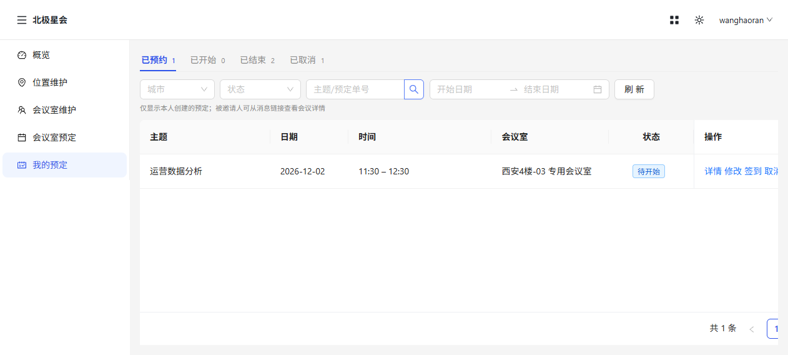 |

- **Controller**：`MeetingMeta`（字典、概览、预定配置、人员姓名）、`Location`（城市/大楼/楼层）、`Room` 与 `RoomFile`（房间台账与图片）、`Booking`（预定/修改/取消/签到/延时/释放/日程）、`SsoExchange`（单点换票）。
- **位置与房间**：城市复用 settings 字典 `ehr.job_city`，大楼/楼层/房间为本服务主数据；房间类型、容量档位、状态、设备、座位布局均取 settings 字典；图片通过 `polaris-file-client` 只存 `file_id`。有会议室的大楼/楼层禁止删除或停用。
- **预定核心**：按当前人员城市过滤可用房间，24 小时 30 分钟粒度时间轴；服务端做同房间时段冲突检测、跨天校验、日期范围校验、房间状态复检、人数上限校验，并通过 `polaris-ehr-client` 获取人员城市与参会人信息。
- **邀请与通知**：邀请参会人写 `meeting_booking_attendee`，通过 `polaris-settings-client` 的站内信/邮件能力发送模板化通知；被邀请人可从消息链接进入详情并查看日程。
- **规则配置**：可预约天数 `meeting.booking.max_advance_days`、单次最长时长 `meeting.booking.max_duration_minutes`、未签到宽限期 `meeting.booking.no_show_grace_minutes`、爽约限制 `meeting.booking.no_show_restriction` 均为 settings 埋点（60 秒缓存），前端从 `/api/meetingroom/config/booking` 读取，服务端做最终边界校验。
- **调度与审计**：`meetingNoShowRelease` 由平台 job 中心派发，按主键游标分批扫描并以 `status=PENDING` 条件更新保证幂等；释放原因记录 `NO_SHOW`，事件以 `SYSTEM` 身份上报审计中心。应用内不自起 `@Scheduled`。
- **数据范围**：「我的预定」按 `creator_id` 过滤；概览月历/日程按本人创建或被邀请口径；统计卡按所选日期统计全平台有效预约，不依赖数据权限结构。

数据表：`meeting_building`、`meeting_floor`、`meeting_room`、`meeting_room_device`、`meeting_booking`、`meeting_booking_attendee`。新权限码按 `meeting:*` 统一登记，菜单与按钮由前端权限控制、服务端 `@Permit` 兜底。

### 5.11 Common 与各 Client

`R<T>` 统一响应、`BizException`/`ErrorCode` 统一异常码、`LoginUser` 安全上下文、JWT 与可信头工具、`ENC(...)` 启动期配置解密；各 `*-client`（sso/client、settings/client、job/client、file/client、audit/client）封装 Feign 契约与 `X-Internal-Token` 注入，不单独启动。

---

## 六、服务、数据库与启动类对照

| 服务 | 端口 | 数据库 | 本地 SQL 初始化 | 启动类 | 可执行 jar |
|---|---:|---|---|---|---|
| Gateway | 9080 | 无 | — | `SsoGatewayApplication` | `polaris-sso-gateway-1.0.0.jar` |
| Auth | 9001 | 账号体系 | — | `SsoAuthApplication` | `polaris-sso-auth-1.0.0.jar` |
| Account | 9002 | `sso_ms` | never | `SsoAccountApplication` | `polaris-sso-account-1.0.0.jar` |
| CMS | 9004 | `cms` | always | `CmsApplication` | `cms-service.jar` |
| Portal | 9005 | 无独立库 | — | `PortalApplication` | `portal-service.jar` |
| EHR | 9006 | `ehr` | always | `EhrApplication` | `ehr-service.jar` |
| Settings | 9007 | `settings` | always | `SettingsApplication` | `settings-service.jar` |
| Job | 9008 | `polaris_job` | always | `JobApplication` | `job-service.jar` |
| Forum | 9009 | `forum` | always | `ForumApplication` | `forum-service.jar` |
| OpenAPI | 9010 | `polaris_openapi` | always | `OpenapiApplication` | `openapi-service.jar` |
| File | 9011 | `polaris_file` | always（生产 never） | `FileApplication` | `file-service.jar` |
| Audit | 9012 | `polaris_audit` | always（生产 never） | `AuditApplication` | `audit-server.jar` |
| 北极星会 Meeting | 9013 | `polaris_meetingroom` | always（生产 never） | `MeetingApplication` | `meeting-service.jar` |

---

## 七、常用环境变量

| 变量 | 用途 |
|---|---|
| `SSO_NACOS_ENABLED` / `SSO_NACOS_DISCOVERY` | Nacos 配置/服务发现开关，默认 false |
| `SSO_JWT_PRIVATE_KEY` / `SSO_JWT_PUBLIC_KEY` | auth 私钥 / Gateway 公钥，必须匹配 |
| `SSO_INTERNAL_TOKEN` | 服务间内部接口令牌，相关服务一致 |
| `SSO_REVOCATION_STORE` | `redis`（默认）或 `memory` |
| `SSO_CONF_KEY` / `SSO_CONF_KEY_FILE` | `ENC(...)` 配置主密钥 |
| `SSO_DB_URL/USER/PASSWORD`、`SSO_SQL_INIT_MODE` | Account 数据库 |
| `EHR_DB_*`、`SETTINGS_DB_*`、`CMS_DB_*`、`JOB_DB_*` | 各业务库 |
| `EHR_APP_SECRET`、`SETTINGS_APP_SECRET`、`CMS_APP_SECRET`、`JOB_APP_SECRET`、`PORTAL_APP_SECRET` | 业务应用换票密钥 |
| `OPENAPI_DB_URL/USER/PASSWORD`、`OPENAPI_SQL_INIT_MODE` | 开放平台库 |
| `OPENAPI_PORT` | 开放平台端口，默认 9010 |
| `OPENAPI_CHANNEL_KEY` | 出站凭证 AES-GCM 主密钥（16/24/32 字节） |
| `OPENAPI_TOKEN_SECRET`、`OPENAPI_TOKEN_TTL_SECONDS` | 开放平台令牌相关 |
| `OPENAPI_SIGNATURE_TOLERANCE_SECONDS` | 签名时间戳容差 |
| `SSO_OPENAPI_APP_CODE` / `SSO_OPENAPI_APP_SECRET` | 开放平台向 sso-auth 换票用的应用凭证 |
| `FILE_DB_*`、`FILE_SQL_INIT_MODE` | 统一文件服务库（生产 `never`） |
| `FILE_SIGN_SECRET` | PRIVATE 文件 HMAC 签名密钥，生产必须替换为随机长串 |
| `FILE_STORAGE_ROOT` / `FILE_PUBLIC_BASE_URL` | 文件存储根目录 / PUBLIC 直链前缀 |
| `AUDIT_DB_*`、`AUDIT_SQL_INIT_MODE` | 统一审计中心库（生产 `never`） |
| `AUDIT_RETENTION_DAYS` | 审计事件保留天数，默认 180 |
| `MEETING_DB_*`、`MEETING_SQL_INIT_MODE` | 北极星会库（生产 `never`） |
| `SSO_MEETING_APP_CODE` / `SSO_MEETING_APP_SECRET` | 北极星会向 sso-auth 换票用的应用凭证 |
| `MEETING_WEB_URL` | 会议详情链接前端基址 |

完整列表以各服务 `application.yml` 为准。

---

## 八、可选：使用 Nacos

本地直连跑通后再启用。参考 `polaris-nacos/README.md` 与 `polaris-nacos/.env.example` 准备私有 `.env` 与密钥文件，检查 `config/local/`，然后：

```bash
python scripts/import-config.py --env local
```

```powershell
$env:SSO_NACOS_ENABLED = "true"
$env:SSO_NACOS_DISCOVERY = "true"   # 只需集中配置时可保持 false
```

`.env`、`.secrets/`、私钥、明文口令不入库。

---

## 九、开发规范

- 分层 `controller → service → mapper`；统一 `R<T>`、`BizException`；关键链路异常不吞。
- 新增表写 `schema.sql`（`CREATE TABLE IF NOT EXISTS`），种子数据写 `data.sql`（`INSERT IGNORE`），保证幂等。
- 新增权限码：后端常量 + 角色权限种子 + 前端按钮/菜单三处同步。
- 审批回调必须幂等；数据权限在服务端执行；空数据范围返回空集。
- 时间用 `LocalDateTime`，输出 `yyyy-MM-dd HH:mm:ss`。
- 敏感配置只用 `${ENV_VAR}` 或 `ENC(...)`；`target/`、`logs/`、上传目录、`.secrets/`、`.env` 不提交。
- 迭代文档放仓库外 `../迭代文档/`，不纳入 Git。

---

## 十、常见问题

1. **Account 启动后没有表**：默认 `SSO_SQL_INIT_MODE=never`，全新库手工执行 account 的 schema/data，或临时改为 `always`。
2. **登录成功但立即 401**：检查 auth 私钥与 Gateway 公钥是否配对、token 是否过期、Redis 吊销配置、请求是否经过 Gateway。
3. **换票失败**：检查 account 中应用是否启用、`base_url` 与前端 origin 是否完全一致、`*_APP_SECRET` 是否匹配；开放平台第三方换票还需检查应用启用状态与密钥是否正确。
4. **内部接口无权限**：确认调用方与被调用方 `SSO_INTERNAL_TOKEN` 一致、路径为 `/internal/**`。
5. **有菜单无数据**：检查功能权限码、应用授权、账号角色与组织数据范围，不要以空范围放行全量。
6. **审批通过但业务未变更**：检查 settings 回调地址（`EHR_SELF_URL`、`CMS_SELF_BASE_URL`）是否可达及内部令牌。
7. **邮件未发送**：未配 SMTP 时只落站内消息；需要邮件配 `SETTINGS_SMTP_*`，开放平台出站渠道还需在「出站渠道」维护凭证与 `auth_config`。
